<div align="center">



</div>

<br/>

## ⚡ `WHO THE HELL AM I`

> AI Engineer · Full Stack Developer · Designer — building things that break the mold.
> Shipping production AI for **Indonesian social intelligence**, hunting alpha with **on-chain data**, obsessed with how money moves.
> Building under **Kryon Labs** ·
> Crew of **VPRIV**.
> Design hard. Code harder. Invest in what grows.

---

## 💀 `WHAT I'M UP TO`

```
[ SHIPPING  ]  ►  Social Intelligence Platform ......... IN PRODUCTION
[ BUILDING  ]  ►  On-Chain Alpha Intelligence (OAI) .... ACTIVE
[ BUILDING  ]  ►  Kryon Labs — studio & umbrella site .. ACTIVE
[ WRITING   ]  ►  RAG for Indonesian Labour Law ........ IN PROGRESS
[ LEARNING  ]  ►  Blockchain · DeFi · Solidity ......... IN PROGRESS
[ TRADING   ]  ►  MNQ · MES futures (prop firm) ........ ALWAYS
[ HUNTING   ]  ►  Web Design Collabs · Hedge Funds ..... OPEN
```

---

## 🧠 `AI & INTELLIGENCE`

| Project | What it does | Stack |
|---|---|---|
| **Social Intelligence Platform** | Microservices that classify emotion & topic in Indonesian social media and generate topic/actor intelligence summaries. Redis caching, rate limiting, auto-promote pipeline for new topics, Qwen3 → Gemini LLM fallback, fully offline GPU AI stack. | `Python` `FastAPI` `Redis` `Gemini` `Ollama` `Qwen3` |
| **Early Warning Intelligence** | Narrative intelligence & early warning dashboard — tracks how narratives spread, clusters similar conversations, flags unusual spread patterns. Never calls anything a hoax: it gives indications, risk scores, and leaves verification to humans. | `AI` `NLP` `Dashboard` |
| **EvidenceGraph** | *"Trace the Claim. Verify the Source."* Traces claim provenance and groups independent sources for social-cyber analysts. Entry for **Kartika Cyber Hackathon 2026** (Social Cyber category). | `AI` `Graph` `Dashboard` |
| **Indonesian Annotation Set** | Gold-standard emotion + topic labels across TikTok and Twitter data, used to evaluate the classifiers. | `Data` `Evaluation` |

---

## 📈 `ON-CHAIN & TRADING`

| Project | What it does | Status |
|---|---|---|
| **On-Chain Alpha Intelligence** | Market, wallet, contract and momentum engines feeding a 0–100 alpha score for meme coin discovery on Robinhood Chain & Hyperliquid. | `BUILDING` |
| **Whale & Insider Tracker** | Follows whale and insider fund flows to spot what they buy early. Wallet finder + insider finder on Robinhood Chain & Arc. | `BUILDING` |
| **Crypto Intelligence Hub** | On-chain data aggregation engine. | `BLUEPRINT` |
| **Hyperliquid Smart Alert** | Tracks wallet activity on Hyperliquid and pushes reports to Telegram. | `LIVE` |
| **Solana Sniper Bot** | Meme coin sniper with a trading-terminal dashboard, signal scoring, Paper ↔ Live switch and a Production Readiness Score. | `ITERATING` |
| **nofomo** | Paper trading platform — practice with virtual money before the meme coin trenches eat you. Web only. | `BUILDING` |

---

## 🧩 `PRODUCTS`

| Project | What it does | Stack |
|---|---|---|
| **DuoFin** | Finance tracking app for couples. Six prototypes deep, now a real codebase. | `FastAPI` `PostgreSQL` `React Native` `Expo` |
| **ERP — Inventory Modernization** | ERP built on open-source Aureus ERP, set up for a Malaysian business (MYR). | `Laravel` `Filament` `MySQL` |

---

## 🎮 `SIDE QUESTS`

```
► NoConsole ...... faceless GTA 6 clip page + AI clipper (hooks, thumbnails, Indo subs)
► Rusty Socks .... animated YouTube Shorts starring a rusty sock. Don't ask.
► BAGGO .......... frog + bag. carry the bag.
```

---

## 📝 `RESEARCH & STAGE TIME`

- 🎤 **CRC 2026** — presented an AI-gated blockchain framework for IoMT vital sign management
- ✍️ **JuTISI** — *Comparing Generative Models for Indonesian Labour-Law QA with Retrieval-Augmented Generation* (in progress)
- 🛡️ **Cyber Hackathon 2026** — EvidenceGraph, Social Cyber category
- 🧪 **QA Automation** — Playwright UI automation & regression testing in fintech

---

## 🛠 `ARSENAL`

<div align="center">


</div>

---
<br/>
<div align="center">

[](mailto:fajarlaksana13@gmail.com)
[](https://github.com/Fajarlaksana)
[](https://x.com/NoConsoleClips)

<br/>

**`" BUILD THINGS THAT MATTER. DESIGN THINGS THAT LAST. INVEST IN WHAT GROWS. "`**

</div>
